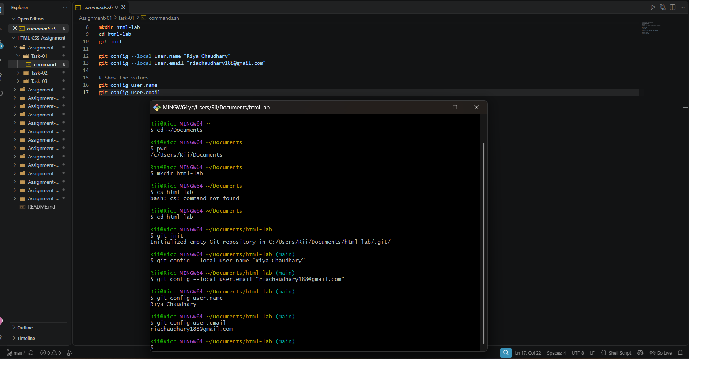
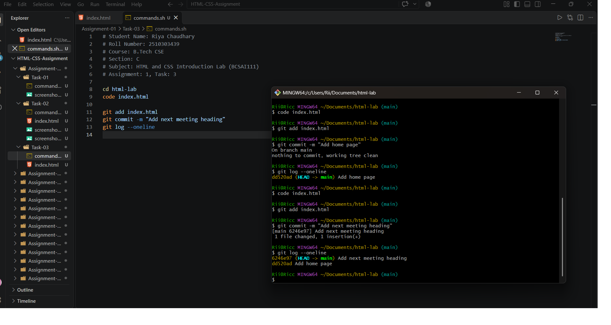

# Assignment 1: Starting a Git Repository

## 1. Experiment Title

Starting a Git Repository and Saving Work with Commits.

## 2. Aim

To start a Git repository for the lab folder, set a local name and email, and save work by making commits.

## 3. Software / Tools Required

- Version Control System: Git
- Terminal: Git Bash / Command Prompt / Linux Terminal
- IDE: VS Code (used to edit index.html)
- Any text editor (if IDE is not available)

## 4. Theory

The following concepts are used in this experiment:

**1. Git:**  
Git is a distributed version control system that records the history of changes made to files in a folder.

**2. Repository:**  
A repository is a folder that Git tracks. The `git init` command creates a new repository in the current folder.

**3. Configuration:**  
The `git config --local` command stores a setting for one repository only. The `user.name` and `user.email` settings are attached to every commit.

**4. Staging and Commit:**  
A file is first added to the staging area with `git add` and then saved permanently in the history with `git commit -m "message"`.

**5. Status and Log:**  
`git status` shows which files are untracked or changed. `git log --oneline` lists the commits in short form, newest first.

## 5. Algorithm / Procedure

### Question 1: Create a Repository and Set User Details

1. Start the program.
2. Create a folder named html-lab and go into it.
3. Run `git init` to start a Git repository.
4. Set the user name with `git config --local user.name`.
5. Set the user email with `git config --local user.email`.
6. Show the values with `git config user.name` and `git config user.email`.
7. Stop the program.

### Question 2: Create index.html and Make the First Commit

1. Start the program.
2. Create index.html inside html-lab with one h1 heading.
3. Run `git status` to see the untracked file.
4. Add the file with `git add index.html`.
5. Commit it with the message "Add home page".
6. Run `git log --oneline`.
7. Stop the program.

### Question 3: Add a Second Heading and Commit

1. Start the program.
2. Open index.html and add an h2 heading below the h1 heading.
3. Add the file with `git add index.html`.
4. Commit it with the message "Add next meeting heading".
5. Run `git log --oneline`.
6. Stop the program.

## 6. Input

The following values are used in the experiment:

**Question 1:**  
Folder = html-lab  
user.name = "Kartikeya Singh"  
user.email = "yashthakur518vitre@gmail.com"

**Question 2:**  
File = index.html  
h1 heading = "Welcome to the HTML Lab"  
Commit message = "Add home page"

**Question 3:**  
h2 heading = "Next meeting"  
Commit message = "Add next meeting heading"

## 7. Output

**Question 1:**  
Each `git config` command prints the value that was set: the user name and the user email.

**Question 2:**  
`git status` lists index.html as untracked. The commit line shows 1 file changed and `git log --oneline` shows the first commit.

**Question 3:**  
Two commits are listed by `git log --oneline`, the newest one first.

**Result:** The Git repository was successfully created, the user details were set, and the changes to index.html were saved as two commits.
