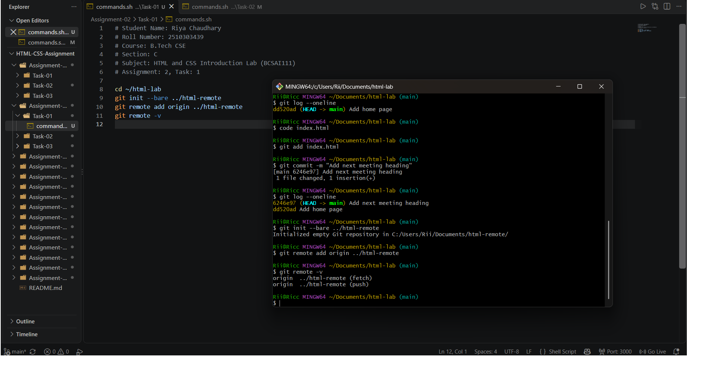
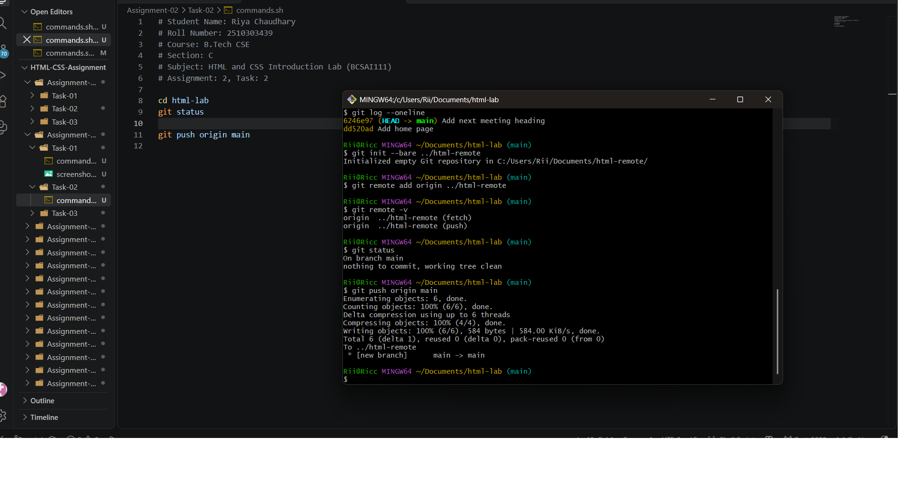
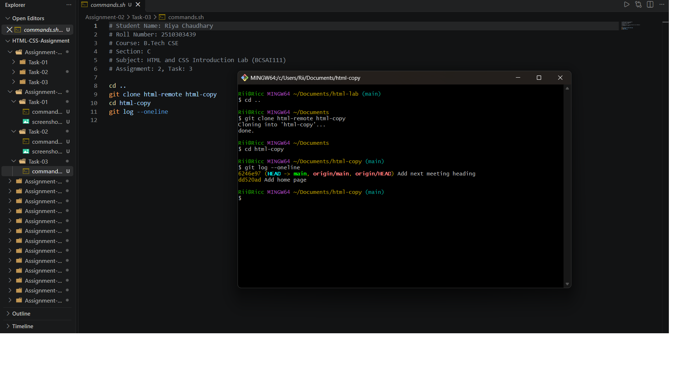

# Assignment 2: Pushing and Cloning a Repository

## 1. Experiment Title

Pushing Commits to a Second Repository and Cloning It.

## 2. Aim

To send the commits to a second repository on the computer and to make a copy of it using clone.

## 3. Software / Tools Required

- Version Control System: Git
- Terminal: Git Bash / Command Prompt / Linux Terminal
- IDE: VS Code (used to edit index.html)
- Any text editor (if IDE is not available)

## 4. Theory

The following concepts are used in this experiment:

**1. Bare Repository:**  
A bare repository (`git init --bare`) has no working files. It only stores the history and is used as a shared or remote repository.

**2. Remote:**  
A remote is a named link to another repository. `git remote add origin <path>` adds a remote called origin and `git remote -v` lists the remotes for fetch and push.

**3. Push:**  
`git push origin main` sends the commits of the local branch to the remote repository.

**4. Clone:**  
`git clone <source> <folder>` makes a full copy of a repository, including its commit history.

## 5. Algorithm / Procedure

### Question 1: Create a Bare Repository and Add the Remote

1. Start the program.
2. Go into the html-lab folder.
3. Run `git init --bare ../html-remote` to create an empty repository next to it.
4. Add it as origin with `git remote add origin ../html-remote`.
5. Run `git remote -v` to list the remotes.
6. Stop the program.

### Question 2: Push the Commits to origin

1. Start the program.
2. Go into the html-lab folder.
3. Run `git status` to check the branch name.
4. Run `git push origin main` (use `git push origin master` if the branch is master).
5. Stop the program.

### Question 3: Clone the Remote Repository

1. Start the program.
2. Go up one folder from html-lab using `cd ..`.
3. Run `git clone html-remote html-copy`.
4. Go into the html-copy folder.
5. Run `git log --oneline`.
6. Stop the program.

## 6. Input

The following values are used in the experiment:

**Question 1:**  
Bare repository = ../html-remote  
Remote name = origin

**Question 2:**  
Remote = origin  
Branch = main

**Question 3:**  
Source = html-remote  
New folder = html-copy

## 7. Output

**Question 1:**  
`git remote -v` lists origin for fetch and for push.

**Question 2:**  
The push ends with a line that shows the branch, such as main -> main.

**Question 3:**  
The same commits appear in html-copy as in html-lab.

**Result:** The commits were successfully pushed to the second repository and a copy of it was made using git clone.
