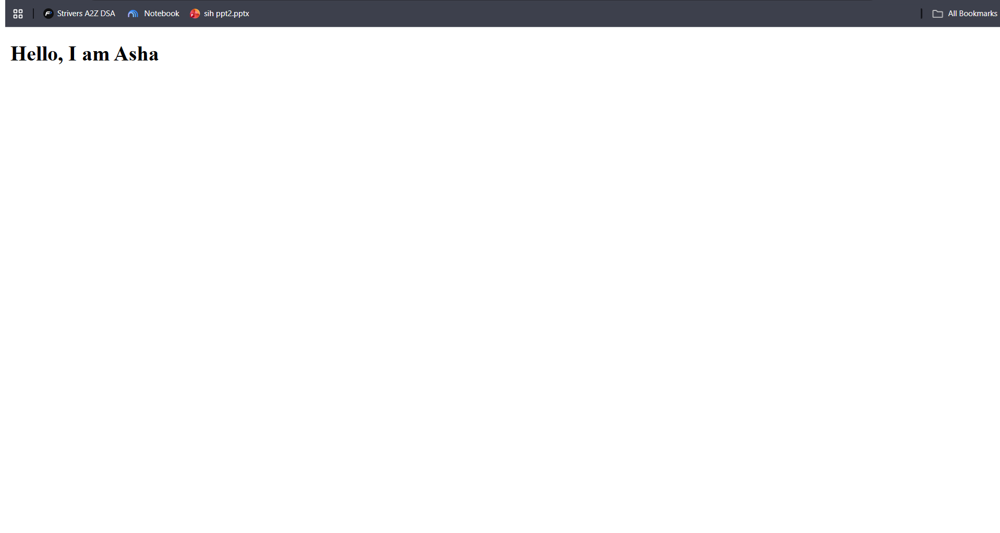
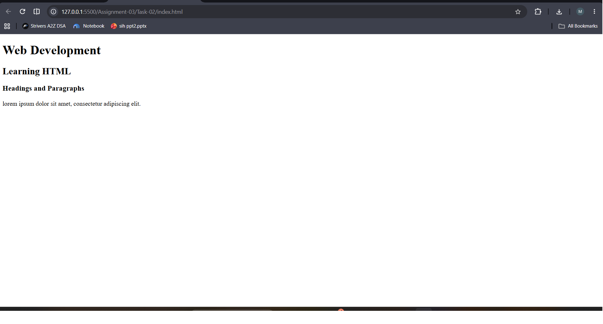
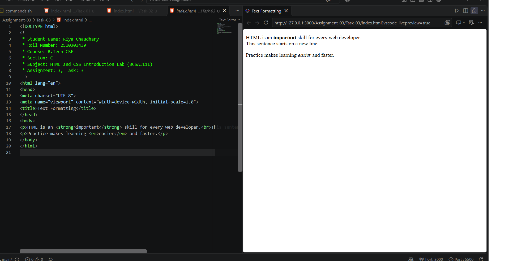

# Assignment 3: Your First HTML Page

## 1. Experiment Title

Writing a First HTML Page with Headings, a Paragraph and Text Formatting.

## 2. Aim

To write a first HTML page with a title, headings and a paragraph, and to format some text.

## 3. Software / Tools Required

- Markup Language: HTML5
- Web Browser: Google Chrome / Microsoft Edge / Firefox
- IDE: VS Code / Sublime Text
- Any text editor (if IDE is not available)

## 4. Theory

The following concepts are used in this experiment:

**1. Document Structure:**  
Every HTML page starts with `<!DOCTYPE html>` and has an `<html>` element that contains a `<head>` and a `<body>`. The `<title>` inside the head is shown on the browser tab.

**2. Headings:**  
HTML has six heading levels, `<h1>` to `<h6>`. Each level is smaller than the one above it.

**3. Paragraph:**  
The `
` element holds a block of text.

**4. Text Formatting:**  
Inline tags change how a word looks.  

- `<strong>` : Marks important text (bold).
- `<em>` : Emphasises text (italic).
- ` ` : Starts a new line inside a paragraph.

## 5. Algorithm / Procedure

### Question 1: First Page

1. Start the program.
2. Write the document structure with `<!DOCTYPE html>`, `<html>`, `<head>` and `<body>`.
3. Set the title to My First Page.
4. Add one h1 heading inside the body.
5. Open the file in a browser.
6. Stop the program.

### Question 2: Headings and a Paragraph

1. Start the program.
2. Write the document structure with the title Headings.
3. Add an h1, an h2 and an h3 heading.
4. Add one paragraph below them.
5. Open the file in a browser.
6. Stop the program.

### Question 3: Text Formatting

1. Start the program.
2. Write the document structure with the title Text Formatting.
3. Add two paragraphs.
4. Wrap one word in `<strong>` and another word in `<em>`.
5. Put a ` ` inside one paragraph.
6. Open the file in a browser.
7. Stop the program.

## 6. Input

The following values are used in the experiment:

**Question 1:**  
Title = "My First Page"  
h1 = "Hello, I am Asha"

**Question 2:**  
h1 = "Web Development"  
h2 = "Learning HTML"  
h3 = "Headings and Paragraphs"  
Paragraph = "lorem ipsum dolor sit amet, consectetur adipiscing elit."

**Question 3:**  
strong word = "important"  
em word = "easier"  
Line break = after "web developer."

## 7. Output

**Question 1:**  
The browser tab says My First Page. The page shows one large heading.

**Question 2:**  
Three headings, each smaller than the one above, and a paragraph under them.

**Question 3:**  
The strong and em words look bold and italic. The line break starts a new line inside the paragraph.

**Result:** A first HTML page with a title, headings, a paragraph and formatted text was successfully written and displayed in the browser.
