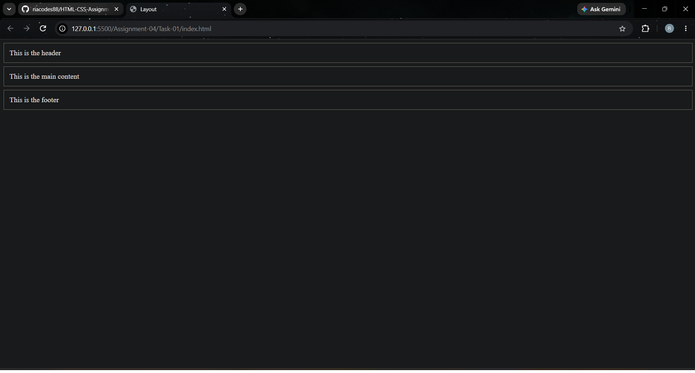
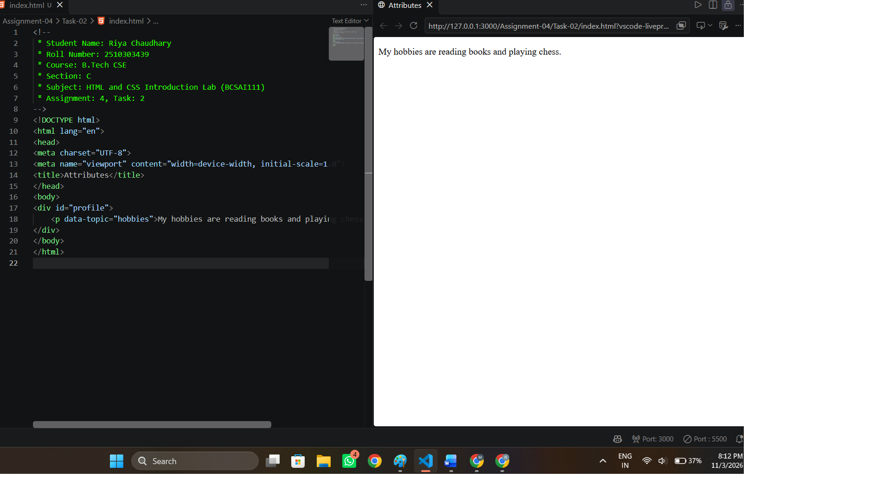
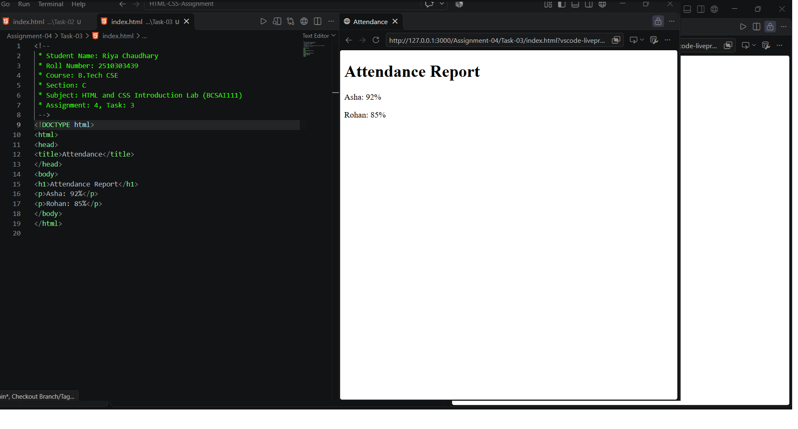

# Assignment 4: Divs, Attributes and a Small Fix

## 1. Experiment Title

Grouping Content with div Elements, Using Attributes and Fixing Errors in HTML.

## 2. Aim

To group parts of a page with div elements, add a data attribute, and fix the errors in a broken page.

## 3. Software / Tools Required

- Programming Language: HTML5 and CSS3
- Web Browser: Google Chrome / Microsoft Edge / Firefox
- IDE: VS Code / Sublime Text
- Any text editor (if IDE is not available)

## 4. Theory

The following concepts are used in this experiment:

**1. div Element:**  
The `
` element is a block container used to group other elements so that they can be styled or arranged together.

**2. Class and Id:**  
The `class` attribute names a group of elements and can be reused. The `id` attribute gives one element a unique name.

**3. Data Attribute:**  
An attribute that starts with `data-` stores extra information in an element. It is not shown on the page.

**4. Common HTML Errors:**  
A page can break because of a missing `>` in the doctype, a tag that is opened but never closed, or a closing tag written as an opening tag.

## 5. Algorithm / Procedure

### Question 1: Three div Blocks

1. Start the program.
2. Create three div elements with the classes header, main and footer.
3. Write some text in each div.
4. Link style.css to give each div a border, padding and margin.
5. Open the file in a browser.
6. Stop the program.

### Question 2: Id and Data Attribute

1. Start the program.
2. Create a div with the id profile.
3. Add a paragraph inside it.
4. Add the attribute `data-topic="hobbies"` to the paragraph.
5. Write any text in the paragraph.
6. Open the file in a browser.
7. Stop the program.

### Question 3: Fix the Broken Page

1. Start the program.
2. Complete the doctype by adding the missing `>` in `<!DOCTYPE html>`.
3. Close the h1 heading with `</h1>`.
4. In the line `
Asha: 92%
`, change the second `
` to the closing tag `
`.
5. Save the corrected page.
6. Open the file in a browser.
7. Stop the program.

## 6. Input

The following values are used in the experiment:

**Question 1:**  
Class header = "This is the header"  
Class main = "This is the main content"  
Class footer = "This is the footer"

**Question 2:**  
div id = "profile"  
data-topic = "hobbies"  
Paragraph = "My hobbies are reading books and playing chess."

**Question 3:**  
h1 = "Attendance Report"  
Asha: 92%  
Rohan: 85%

## 7. Output

**Question 1:**  
Three blocks appear in order: header, main and footer.

**Question 2:**  
The paragraph text shows. The data-topic attribute is not visible on the page.

**Question 3:**  
The corrected page shows the heading Attendance Report and two lines: Asha: 92% and Rohan: 85%.

**Result:** The div blocks, the data attribute and the corrected attendance page were successfully created and displayed in the browser.
