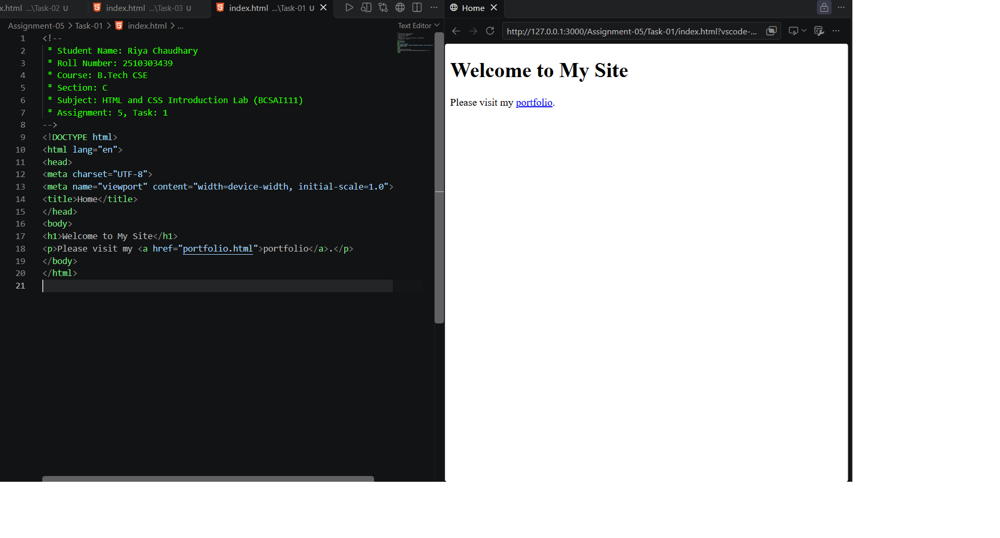
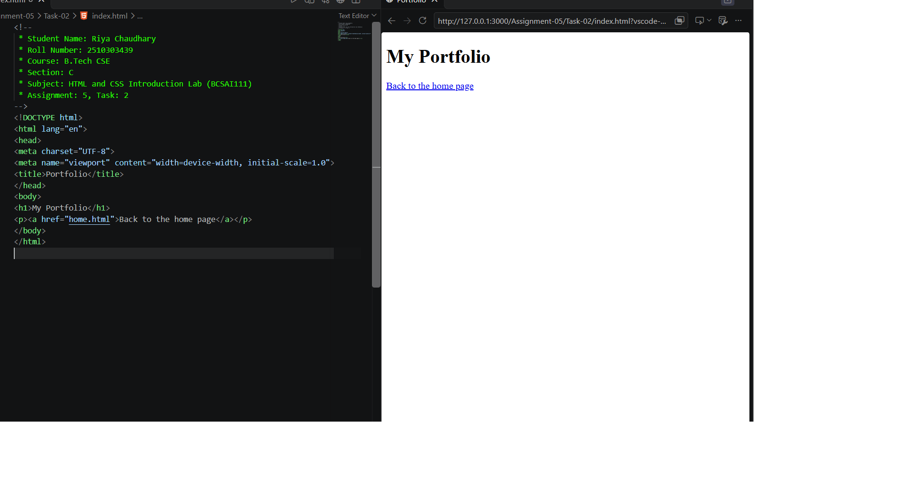
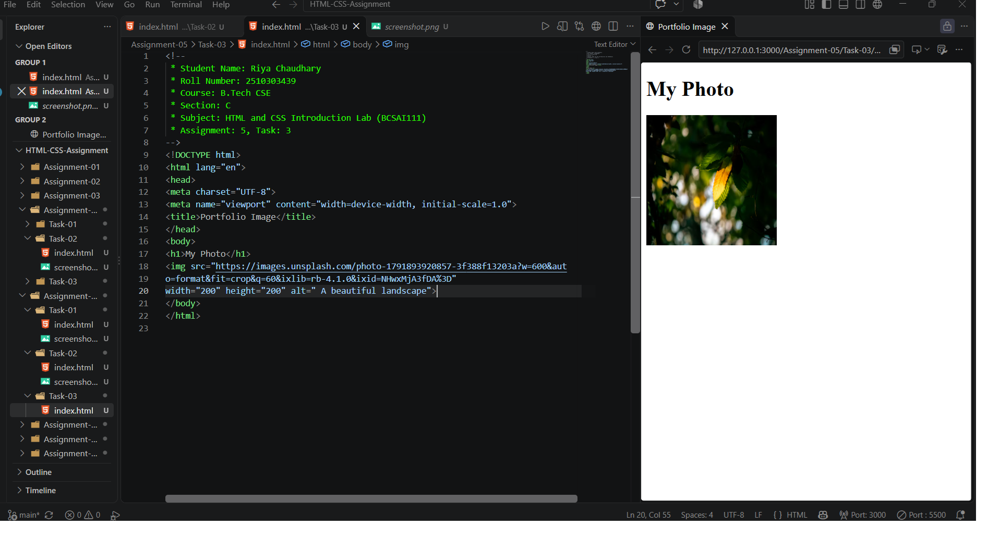

# Assignment 5: Links and Images

## 1. Experiment Title

Linking Two HTML Pages and Adding an Image with Alt Text.

## 2. Aim

To link two pages together and to add a picture with alt text.

## 3. Software / Tools Required

- Markup Language: HTML5
- Web Browser: Google Chrome / Microsoft Edge / Firefox
- IDE: VS Code / Sublime Text
- Any text editor (if IDE is not available)

## 4. Theory

The following concepts are used in this experiment:

**1. Hyperlink:**  
The `<a>` (anchor) element creates a link. The `href` attribute holds the address of the page to open.

**2. Linking Pages:**  
Two pages in the same folder can link to each other by using the file name in `href`, for example `href="portfolio.html"`.

**3. Image:**  
The `` element shows a picture. The `src` attribute gives its address and the `width` and `height` attributes set its size.

**4. Alt Text:**  
The `alt` attribute describes the picture. It is shown if the picture is missing and is read out by screen readers.

## 5. Algorithm / Procedure

### Question 1: Home Page with a Link

1. Start the program.
2. Create the page with the heading Welcome to My Site.
3. Add a paragraph.
4. Add a link to portfolio.html with the link text portfolio.
5. Open the file in a browser.
6. Stop the program.

### Question 2: Portfolio Page with a Link Back

1. Start the program.
2. Create the page with a heading.
3. Add a link to home.html with some link text.
4. Open the file in a browser.
5. Stop the program.

### Question 3: Image with Alt Text

1. Start the program.
2. Create the page with a heading.
3. Add an `` element with the picture address in `src`.
4. Set the width and height to 200 each.
5. Write alt text that describes the picture.
6. Open the file in a browser.
7. Stop the program.

## 6. Input

The following values are used in the experiment:

**Question 1:**  
h1 = "Welcome to My Site"  
Link text = "portfolio"  
href = "portfolio.html"

**Question 2:**  
h1 = "My Portfolio"  
Link text = "Back to the home page"  
href = "home.html"

**Question 3:**  
h1 = "My Photo"  
width = 200  
height = 200  
alt = "A beautiful landscape"

## 7. Output

**Question 1:**  
Clicking the word portfolio opens the portfolio page.

**Question 2:**  
The link goes back to the home page.

**Question 3:**  
A 200 by 200 photo appears under the heading. If the picture is missing, the alt text shows instead.

**Result:** Two linked pages and a page with a 200 by 200 image and alt text were successfully created and displayed in the browser.
