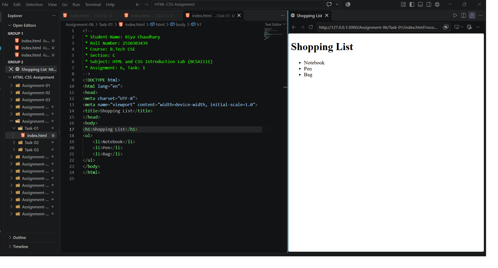
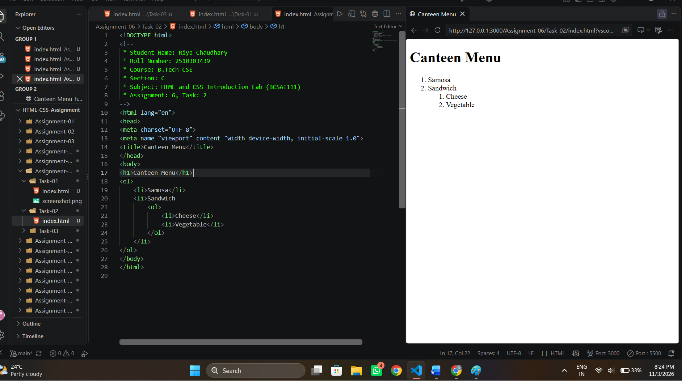
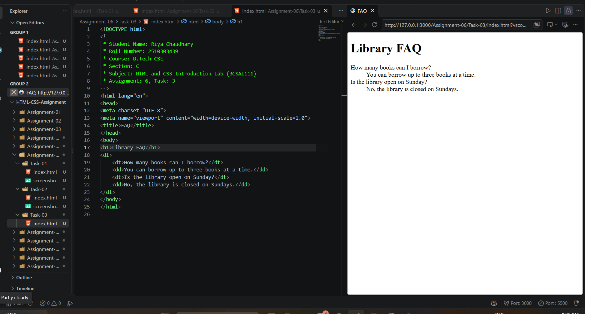

# Assignment 6: Types of HTML Lists

## 1. Experiment Title

Creating Unordered, Ordered (Nested) and Description Lists in HTML.

## 2. Aim

To make a bulleted list, a numbered list with a nested list, and a description list.

## 3. Software / Tools Required

- Markup Language: HTML5
- Web Browser: Google Chrome / Microsoft Edge / Firefox
- IDE: VS Code / Sublime Text
- Any text editor (if IDE is not available)

## 4. Theory

The following concepts are used in this experiment:

**1. Unordered List:**  
The `<ul>` element makes a bulleted list. Each item is written in an `<li>` element.

**2. Ordered List:**  
The `<ol>` element makes a numbered list. Each item is written in an `<li>` element.

**3. Nested List:**  
A list placed inside an `<li>` element becomes a sub-list of that item.

**4. Description List:**  
The `<dl>` element makes a list of terms and their descriptions.  

- `<dt>` : Holds the term (here, the question).
- `<dd>` : Holds the description (here, the answer).

## 5. Algorithm / Procedure

### Question 1: Unordered List

1. Start the program.
2. Create the page with the heading Shopping List.
3. Add a `<ul>` with three `<li>` items.
4. Open the file in a browser.
5. Stop the program.

### Question 2: Ordered List with a Nested List

1. Start the program.
2. Create the page with the heading Canteen Menu.
3. Add an `<ol>` with the items Samosa and Sandwich.
4. Inside the Sandwich item, add a nested `<ol>` with the items Cheese and Vegetable.
5. Open the file in a browser.
6. Stop the program.

### Question 3: Description List

1. Start the program.
2. Create the page with a heading.
3. Add a `<dl>` element.
4. Write each question in a `<dt>` element.
5. Write each answer in a `<dd>` element.
6. Open the file in a browser.
7. Stop the program.

## 6. Input

The following values are used in the experiment:

**Question 1:**  
h1 = "Shopping List"  
Items = Notebook, Pen, Bag

**Question 2:**  
h1 = "Canteen Menu"  
Items = Samosa, Sandwich  
Nested items = Cheese, Vegetable

**Question 3:**  
h1 = "Library FAQ"  
Q1 = "How many books can I borrow?"  
Q2 = "Is the library open on Sunday?"

## 7. Output

**Question 1:**  
Three bullet points are shown under the heading.

**Question 2:**  
Two numbered items are shown, and a smaller numbered list appears under the second one.

**Question 3:**  
Two questions are shown, each followed by its answer.

**Result:** The unordered list, the nested ordered list and the description list were successfully created and displayed in the browser.
