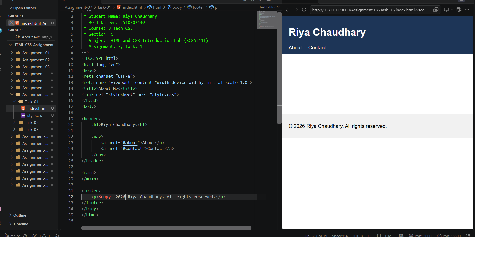
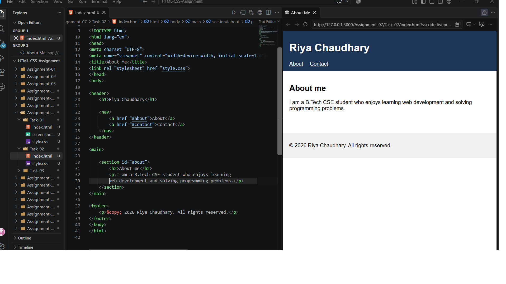
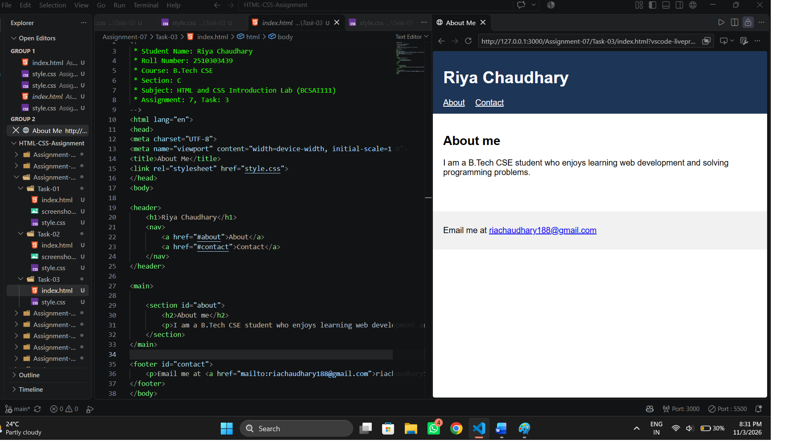

# Assignment 7: About Me Page

## 1. Experiment Title

Building an About Me Page with Semantic Tags and a Contact Link.

## 2. Aim

To build a short About Me page with semantic tags, an about section and a contact link.

## 3. Software / Tools Required

- Programming Language: HTML5 and CSS3
- Web Browser: Google Chrome / Microsoft Edge / Firefox
- IDE: VS Code / Sublime Text
- Any text editor (if IDE is not available)

## 4. Theory

The following concepts are used in this experiment:

**1. Semantic Tags:**  
Semantic tags describe the meaning of each part of a page.  

- `<header>` : The top part of the page, such as the name and navigation.
- `<nav>` : A group of navigation links.
- `<main>` : The main content of the page.
- `<section>` : A group of related content.
- `<footer>` : The bottom part of the page.

**2. Anchor Links:**  
A link such as `href="#about"` jumps to the element whose id is about on the same page.

**3. Email Link:**  
A link with `href="mailto:address"` opens the default email program when clicked.

## 5. Algorithm / Procedure

### Question 1: Header, Empty main and Footer

1. Start the program.
2. Create a `<header>` with an h1 and a `<nav>`.
3. Add two links in the nav: About to #about and Contact to #contact.
4. Add an empty `<main>` and a `<footer>`.
5. Link style.css to style the page.
6. Open the file in a browser.
7. Stop the program.

### Question 2: About Section

1. Start the program.
2. Add a `<section>` with the id about inside `<main>`.
3. Add an h2 heading About me.
4. Add one paragraph about yourself.
5. Open the file in a browser.
6. Stop the program.

### Question 3: Contact Footer

1. Start the program.
2. Give the footer the id contact.
3. Add a paragraph inside the footer.
4. Add a link with `mailto:` in the href and the email address as the link text.
5. Open the file in a browser and click Contact in the nav.
6. Stop the program.

## 6. Input

The following values are used in the experiment:

**Question 1:**  
h1 = "Kartikeya Singh"  
Links = About (#about), Contact (#contact)

**Question 2:**  
section id = "about"  
h2 = "About me"  
Paragraph = "I am a B.Tech CSE student who enjoys learning web development and solving programming problems."

**Question 3:**  
footer id = "contact"  
Email = yashthakur518vitre@gmail.com

## 7. Output

**Question 1:**  
The name appears at the top with two links. The middle and bottom are empty.

**Question 2:**  
The About me heading and a paragraph appear under the top links.

**Question 3:**  
The footer shows a clickable email address. The Contact link in the top nav jumps to it.

**Result:** The About Me page with semantic tags, an about section and a contact email link was successfully built and displayed in the browser.
