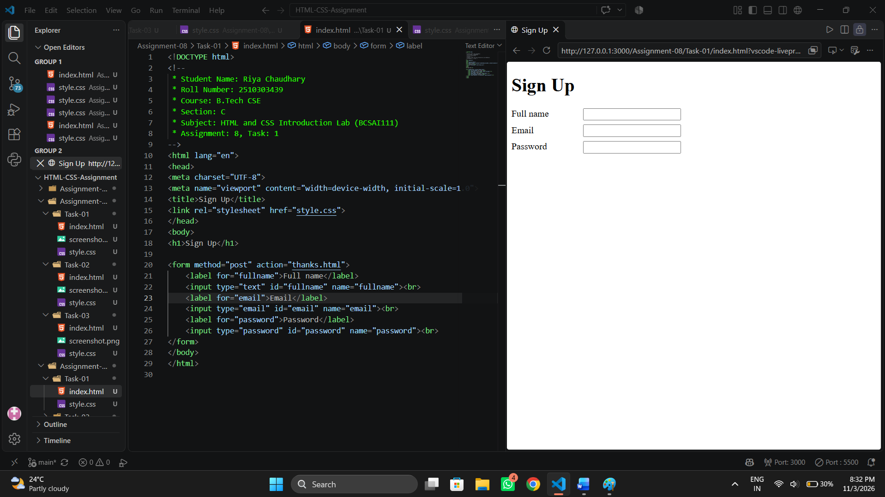
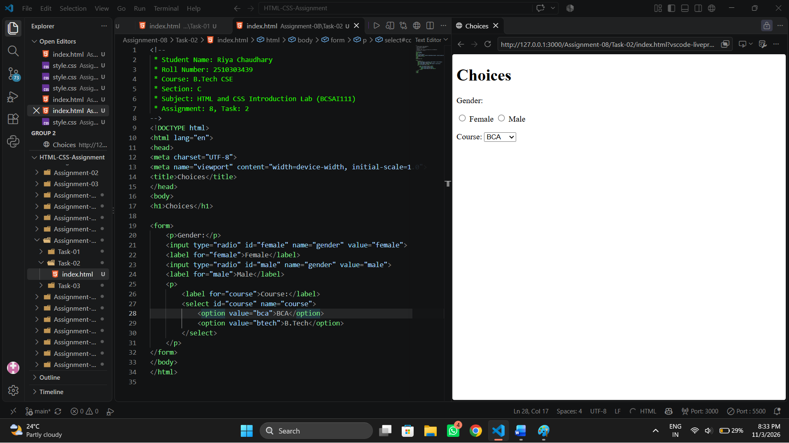
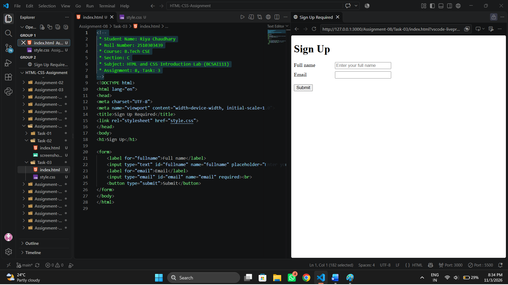

# Assignment 8: Sign-Up Forms and Choices

## 1. Experiment Title

Creating Forms with Labelled Fields, Radio Buttons, a Dropdown and Required Fields.

## 2. Aim

To make a labelled form with text, email and password fields, choices and a submit button.

## 3. Software / Tools Required

- Programming Language: HTML5 and CSS3
- Web Browser: Google Chrome / Microsoft Edge / Firefox
- IDE: VS Code / Sublime Text
- Any text editor (if IDE is not available)

## 4. Theory

The following concepts are used in this experiment:

**1. Form:**  
The `<form>` element collects user input. The `method` attribute sets how data is sent and the `action` attribute sets where it is sent.

**2. Input Types:**  
The `<input>` element changes with its `type`.  

- `text` : A single-line text box.
- `email` : A box that checks for an email format.
- `password` : A box that hides the typed characters.
- `radio` : A button where only one choice in a group can be selected.

**3. Label:**  
The `<label>` element names a field. Its `for` attribute matches the `id` of the field, so clicking the label selects the field.

**4. Dropdown:**  
The `<select>` element shows a list of `<option>` choices.

**5. Required and Placeholder:**  
The `required` attribute stops the form from being sent when the field is empty. The `placeholder` attribute shows a hint inside an empty field.

## 5. Algorithm / Procedure

### Question 1: Sign-Up Form

1. Start the program.
2. Create a form with method post and action thanks.html.
3. Add labelled fields for full name, email and password.
4. Link each label to its field with the for and id attributes.
5. Link style.css to align the labels.
6. Open the file in a browser.
7. Stop the program.

### Question 2: Radio Buttons and Dropdown

1. Start the program.
2. Add two radio buttons with the same name gender: Female and Male.
3. Add a label for each radio button.
4. Add a select dropdown named course with the options BCA and B.Tech.
5. Open the file in a browser.
6. Stop the program.

### Question 3: Required Fields

1. Start the program.
2. Add a full name field and an email field.
3. Add the `required` attribute to both fields.
4. Add a placeholder to the name field.
5. Add a Submit button.
6. Open the file in a browser and click Submit with an empty field.
7. Stop the program.

## 6. Input

The following values are used in the experiment:

**Question 1:**  
method = "post"  
action = "thanks.html"  
Fields = Full name, Email, Password

**Question 2:**  
Gender = Female, Male  
Course = BCA, B.Tech

**Question 3:**  
Name placeholder = "Enter your full name"  
Fields = Full name, Email (both required)

## 7. Output

**Question 1:**  
Three labelled boxes are shown. The password box hides the characters typed in it.

**Question 2:**  
Only one gender can be selected. The dropdown shows the two courses.

**Question 3:**  
Leaving a required field empty shows a message from the browser.

**Result:** The sign-up form, the radio buttons with the dropdown and the form with required fields were successfully created and tested in the browser.
