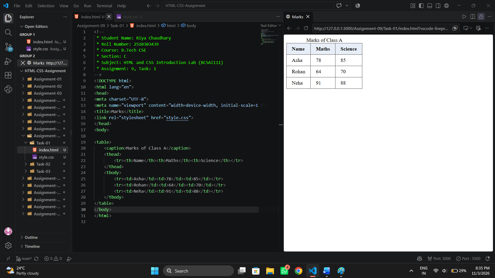
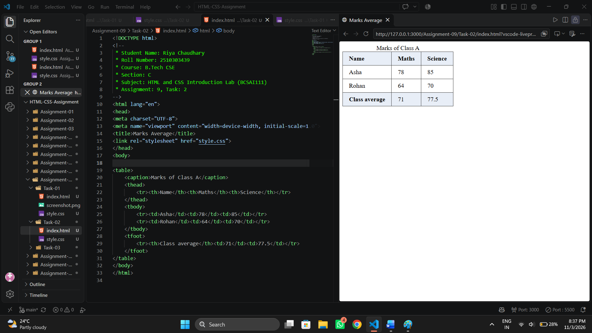
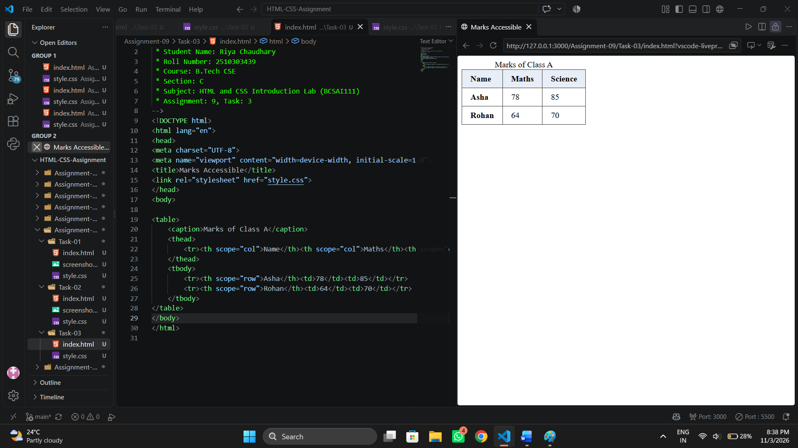

# Assignment 9: Tables with Headers and Footers

## 1. Experiment Title

Building HTML Tables with a Caption, Header, Body, Footer and Scope Attributes.

## 2. Aim

To build a table with a caption, a header, rows and a footer, and to add scope attributes.

## 3. Software / Tools Required

- Programming Language: HTML5 and CSS3
- Web Browser: Google Chrome / Microsoft Edge / Firefox
- IDE: VS Code / Sublime Text
- Any text editor (if IDE is not available)

## 4. Theory

The following concepts are used in this experiment:

**1. Table:**  
The `<table>` element shows data in rows and columns. A row is written with `<tr>`, a header cell with `<th>` and a data cell with `<td>`.

**2. Table Sections:**  
A table can be divided into parts.  

- `<caption>` : The title of the table.
- `<thead>` : The header rows.
- `<tbody>` : The main rows.
- `<tfoot>` : The footer rows, such as totals or averages.

**3. Scope Attribute:**  
The `scope` attribute tells assistive technology what a header cell describes: `scope="col"` for a column and `scope="row"` for a row.

**4. Average:**  
Average = Sum of the values / Number of values.

## 5. Algorithm / Procedure

### Question 1: Marks Table

1. Start the program.
2. Add a table with the caption Marks of Class A.
3. Put the header row Name, Maths, Science in `<thead>`.
4. Put three student rows in `<tbody>`.
5. Link style.css to add borders and padding.
6. Open the file in a browser.
7. Stop the program.

### Question 2: Table with an Average Footer

1. Start the program.
2. Use the same caption and header as the first table.
3. Keep the Asha and Rohan rows only.
4. Calculate the Maths average = (78 + 64) / 2 = 71.
5. Calculate the Science average = (85 + 70) / 2 = 77.5.
6. Add a `<tfoot>` row called Class average with the two averages.
7. Open the file in a browser.
8. Stop the program.

### Question 3: Accessible Table

1. Start the program.
2. Use the same caption, header and Asha and Rohan rows, without the footer row.
3. Add `scope="col"` to each header cell.
4. Make each name cell a `<th>` with `scope="row"`.
5. Open the file in a browser and check the scope attributes in the Elements panel.
6. Stop the program.

## 6. Input

The following values are used in the experiment:

**Question 1:**  
Asha = 78, 85  
Rohan = 64, 70  
Neha = 91, 88

**Question 2:**  
Asha = 78, 85  
Rohan = 64, 70

**Question 3:**  
Asha = 78, 85  
Rohan = 64, 70

## 7. Output

**Question 1:**  
A table with a header row and three student rows is shown.

**Question 2:**  
The footer row at the bottom shows the two averages: 71 and 77.5.

**Question 3:**  
The table looks the same. The header and name cells carry the scope attributes.

**Result:** The marks table, the table with the average footer and the accessible table with scope attributes were successfully created and displayed in the browser.
