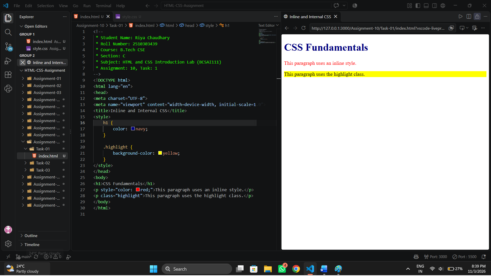
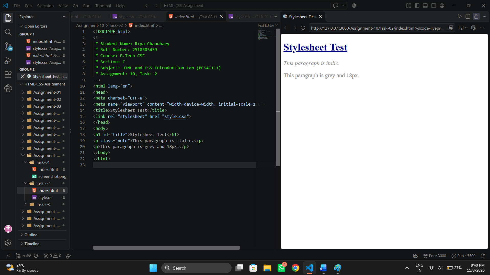
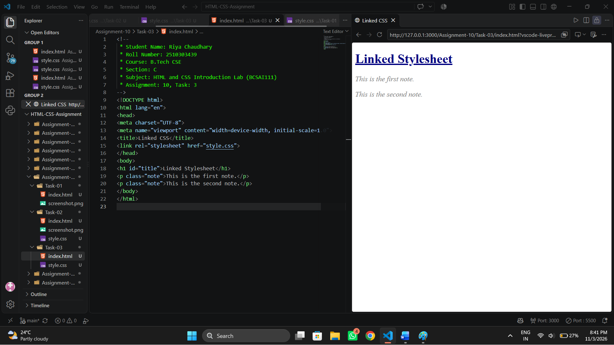

# Assignment 10: CSS Fundamentals

## 1. Experiment Title

Applying CSS in Three Ways and Using Selectors and Text Styles.

## 2. Aim

To apply CSS in three ways (inline, internal and linked) and to use selectors and text styles.

## 3. Software / Tools Required

- Programming Language: HTML5 and CSS3
- Web Browser: Google Chrome / Microsoft Edge / Firefox
- IDE: VS Code / Sublime Text
- Any text editor (if IDE is not available)

## 4. Theory

The following concepts are used in this experiment:

**1. CSS:**  
Cascading Style Sheets (CSS) control the look of an HTML page, such as colour, size and spacing.

**2. Ways to Add CSS:**  

- Inline : The `style` attribute inside one element.
- Internal : A `<style>` block inside the `<head>`.
- Linked : An external .css file added with `<link rel="stylesheet" href="style.css">`.

**3. Selectors:**  

- Element selector : `h1` selects all h1 elements.
- Class selector : `.note` selects elements with class="note".
- Id selector : `#title` selects the element with id="title".

**4. Text Properties:**  

- `color` : Sets the text colour.
- `font-size` : Sets the text size.
- `font-style` : Makes the text italic.
- `text-decoration` : Adds an underline.

## 5. Algorithm / Procedure

### Question 1: Inline and Internal CSS

1. Start the program.
2. In the head, add a `<style>` block that makes h1 navy and gives the class highlight a yellow background.
3. Add an h1 heading in the body.
4. Add a paragraph with an inline style that makes its text red.
5. Add a paragraph with the class highlight.
6. Open the file in a browser.
7. Stop the program.

### Question 2: Stylesheet with Selectors

1. Start the program.
2. Create style.css.
3. Make all h1 elements navy.
4. Make the class note italic.
5. Underline the id title.
6. Set all p elements to font size 18px and a grey colour.
7. Link the file to a test page and open it in a browser.
8. Stop the program.

### Question 3: Linked CSS

1. Start the program.
2. Link style.css in the head.
3. Add an h1 with the id title.
4. Add two paragraphs with the class note.
5. Open the file in a browser.
6. Stop the program.

## 6. Input

The following values are used in the experiment:

**Question 1:**  
h1 colour = navy  
.highlight background = yellow  
Inline paragraph colour = red

**Question 2:**  
h1 = navy  
.note = italic  
#title = underline  
p = 18px, grey

**Question 3:**  
h1 id = "title"  
Paragraphs class = "note" (two)

## 7. Output

**Question 1:**  
A navy heading, one red paragraph and one yellow paragraph are shown.

**Question 2:**  
Once linked, the headings, notes and paragraphs use the new styles.

**Question 3:**  
The page is styled only when style.css is in the same folder.

**Result:** CSS was successfully applied to the pages using inline, internal and linked styles with element, class and id selectors.
