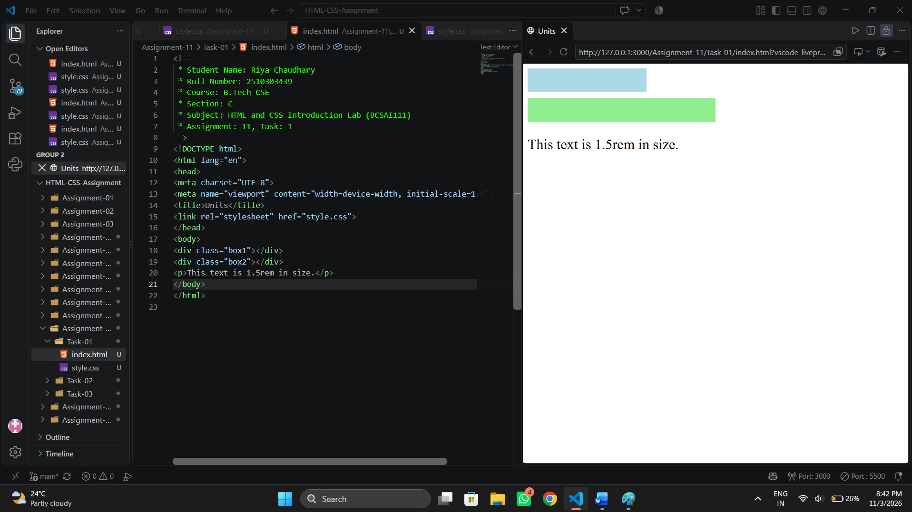
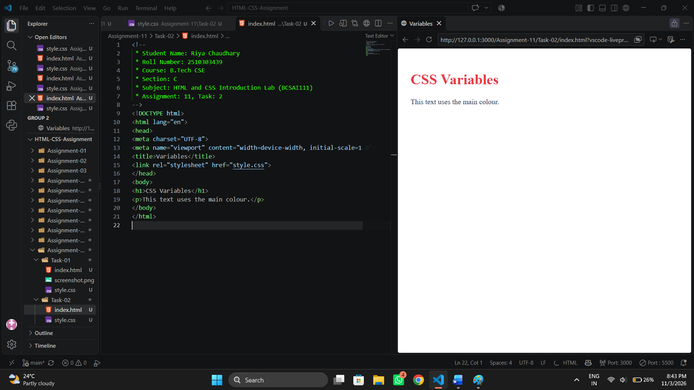
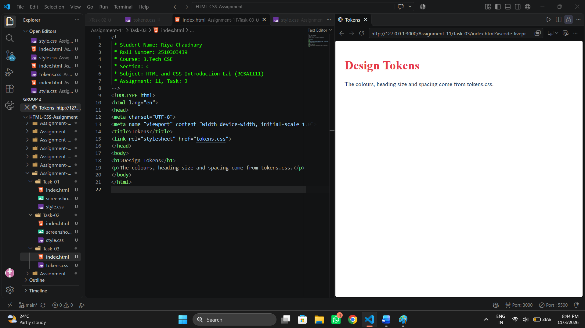

# Assignment 11: Units and CSS Variables

## 1. Experiment Title

Using CSS Units and Storing Colours and Spacing in CSS Variables.

## 2. Aim

To use CSS units and to store colours and spacing in variables.

## 3. Software / Tools Required

- Programming Language: HTML5 and CSS3
- Web Browser: Google Chrome / Microsoft Edge / Firefox
- IDE: VS Code / Sublime Text
- Any text editor (if IDE is not available)

## 4. Theory

The following concepts are used in this experiment:

**1. CSS Units:**  

- `px` : A fixed size in pixels.
- `%` : A size relative to the parent element.
- `rem` : A size relative to the font size of the root element.

**2. CSS Variables:**  
A variable is defined with two dashes, for example `--main-color: #1d3557;`, and is used with `var(--main-color)`.

**3. The :root Selector:**  
Variables defined in `:root` can be used anywhere in the page.

**4. Design Tokens:**  
Colours, sizes and spacing kept as variables in one CSS file can be reused by many pages.

## 5. Algorithm / Procedure

### Question 1: CSS Units

1. Start the program.
2. Add a div box 200px wide and 40px high with a background colour.
3. Add a div box 50% wide and 40px high with a background colour.
4. Add a paragraph of any text.
5. Set the paragraph font size to 1.5rem.
6. Open the file in a browser.
7. Stop the program.

### Question 2: CSS Variables

1. Start the program.
2. In `:root`, define --main-color as #1d3557, --accent-color as #e63946 and --page-padding as 20px.
3. Use `var()` for the body colour and padding.
4. Use `var()` for the h1 colour.
5. Open the file in a browser.
6. Stop the program.

### Question 3: Design Tokens File

1. Start the program.
2. Create tokens.css with variables for the primary colour, accent colour, heading size and spacing.
3. Use the variables for the body colour and padding.
4. Use the variables for the h1 colour and size.
5. Link tokens.css to a page and open it in a browser.
6. Stop the program.

## 6. Input

The following values are used in the experiment:

**Question 1:**  
Box 1 = 200px x 40px  
Box 2 = 50% x 40px  
Font size = 1.5rem

**Question 2:**  
--main-color = #1d3557  
--accent-color = #e63946  
--page-padding = 20px

**Question 3:**  
--primary-color = #1d3557  
--accent-color = #e63946  
--heading-size = 2rem  
--spacing = 16px

## 7. Output

**Question 1:**  
A 200 pixel box, a half-width box and larger text are shown.

**Question 2:**  
The heading uses the accent colour. The text uses the main colour.

**Question 3:**  
Linked to a page, the file sets the colours, heading size and spacing.

**Result:** CSS units and CSS variables were successfully used to set sizes, colours and spacing on the pages.
