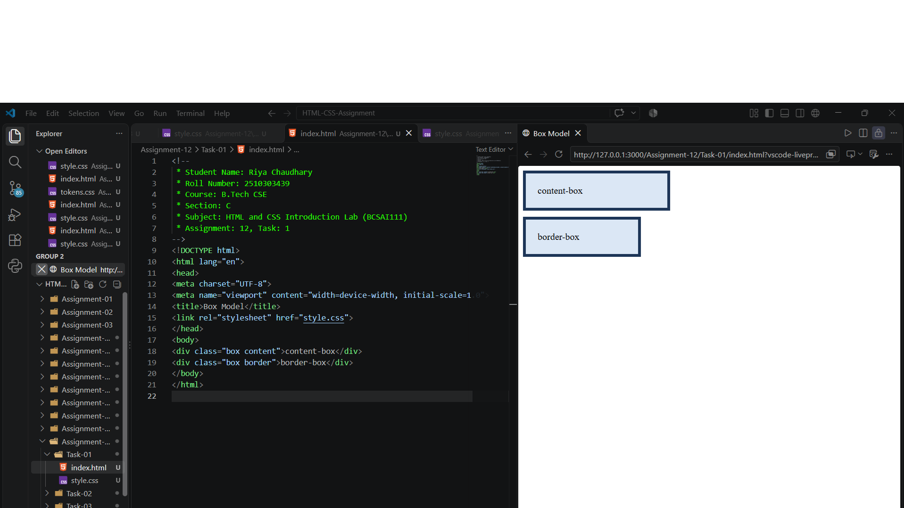
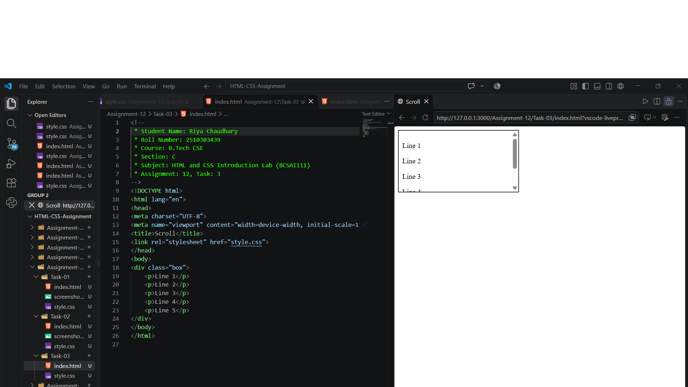

# Assignment 12: Box Model, Cards and Scrolling

## 1. Experiment Title

Comparing Box Sizing Types, Styling a Card and Making a Box Scroll.

## 2. Aim

To compare the box sizing types, to style a card and to make a box scroll.

## 3. Software / Tools Required

- Programming Language: HTML5 and CSS3
- Web Browser: Google Chrome / Microsoft Edge / Firefox
- IDE: VS Code / Sublime Text
- Any text editor (if IDE is not available)

## 4. Theory

The following concepts are used in this experiment:

**1. Box Model:**  
Every element is a box made of content, padding, border and margin.

**2. box-sizing:**  

- `content-box` : The width applies to the content only. Padding and border are added to it.
- `border-box` : The width includes the content, padding and border.

**3. Card:**  
A card is a box with a background colour, border, rounded corners (`border-radius`) and padding that groups related content.

**4. Overflow:**  
When content is larger than its box, `overflow: auto` adds a scroll bar to the box.

## 5. Algorithm / Procedure

### Question 1: content-box and border-box

1. Start the program.
2. Create two div boxes.
3. Give both a width of 200px, padding of 20px and a border of 5px.
4. Set box-sizing content-box on the first box.
5. Set box-sizing border-box on the second box.
6. Open the file in a browser.
7. Stop the program.

### Question 2: Card

1. Start the program.
2. Create a div with the class card.
3. Set a background colour, a 2px border, border-radius 12px and padding 16px.
4. Put an h3 heading and a paragraph inside it.
5. Open the file in a browser.
6. Stop the program.

### Question 3: Scrolling Box

1. Start the program.
2. Create a div box with a fixed height of 120px.
3. Set overflow to auto.
4. Add five paragraphs, Line 1 to Line 5, inside the box.
5. Open the file in a browser.
6. Stop the program.

## 6. Input

The following values are used in the experiment:

**Question 1:**  
width = 200px  
padding = 20px  
border = 5px

**Question 2:**  
border = 2px  
border-radius = 12px  
padding = 16px  
h3 = "Web Design"

**Question 3:**  
height = 120px  
overflow = auto  
Lines = Line 1 to Line 5

## 7. Output

**Question 1:**  
The content-box box is wider (250px in total) than the border-box box (200px in total).

**Question 2:**  
A card with rounded corners, a border and a coloured background is shown.

**Question 3:**  
The lines do not fit in the box, so the box can be scrolled.

**Result:** The box sizing types were compared, a card was styled and a scrolling box was successfully created.
