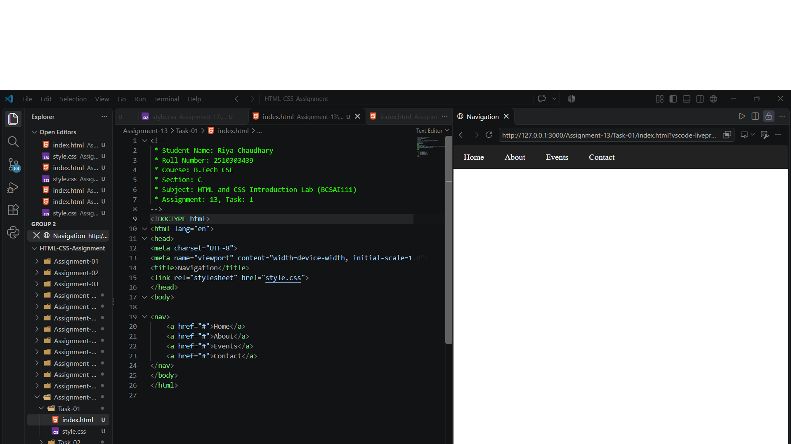
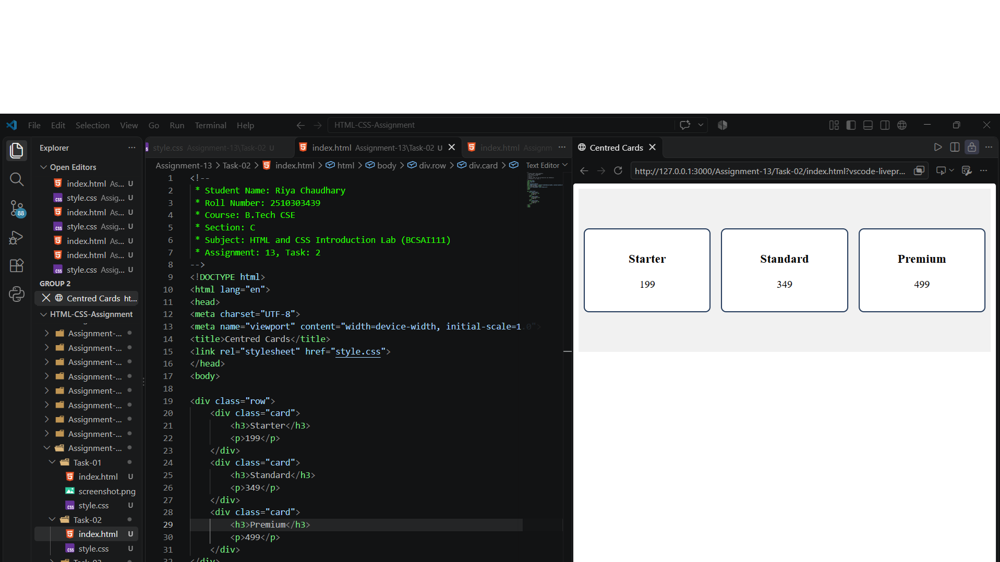
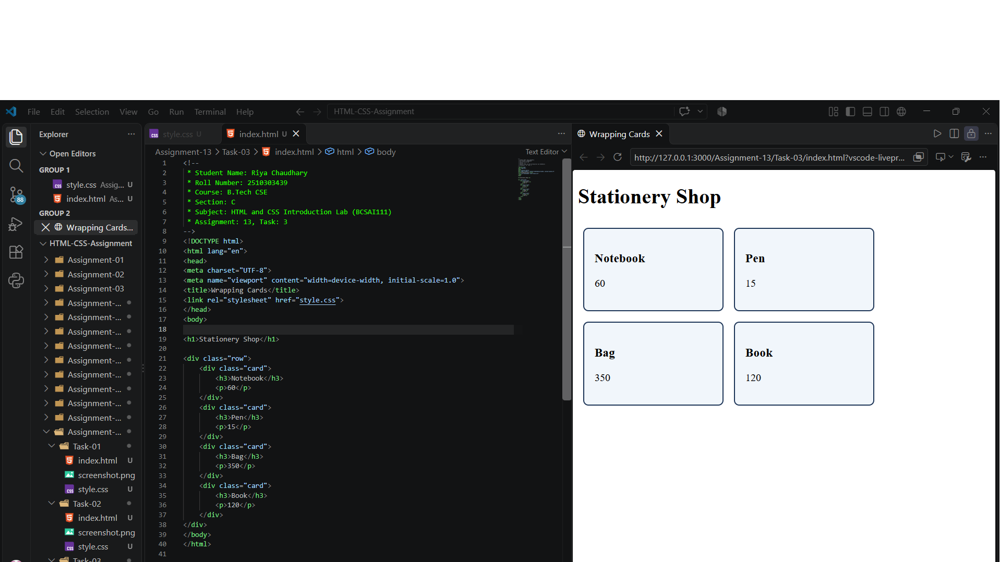

# Assignment 13: Flexbox Layouts

## 1. Experiment Title

Creating a Navigation Bar, Centred Cards and Wrapping Cards Using Flexbox.

## 2. Aim

To lay out a navigation bar, centred cards and cards that wrap, using Flexbox.

## 3. Software / Tools Required

- Programming Language: HTML5 and CSS3
- Web Browser: Google Chrome / Microsoft Edge / Firefox
- IDE: VS Code / Sublime Text
- Any text editor (if IDE is not available)

## 4. Theory

The following concepts are used in this experiment:

**1. Flexbox:**  
Flexbox is a CSS layout method. Setting `display: flex` on a container places its children in a row.

**2. Alignment:**  

- `justify-content` : Aligns the items along the main (horizontal) axis.
- `align-items` : Aligns the items along the cross (vertical) axis.

**3. flex-wrap:**  
With `flex-wrap: wrap`, items that do not fit in one row move to the next row.

**4. Navigation Bar:**  
A `<nav>` element with `display: flex` shows its links side by side.

## 5. Algorithm / Procedure

### Question 1: Navigation Bar

1. Start the program.
2. Create a `<nav>` element with four links: Home, About, Events and Contact.
3. Set `display: flex` on the nav.
4. Give the nav a dark background.
5. Make the link text white.
6. Open the file in a browser.
7. Stop the program.

### Question 2: Centred Cards

1. Start the program.
2. Create a div with the class row and three cards inside it.
3. Write an h3 heading and a price paragraph in each card.
4. Set `display: flex` on the row.
5. Use `justify-content` and `align-items` to centre the cards.
6. Open the file in a browser.
7. Stop the program.

### Question 3: Wrapping Cards

1. Start the program.
2. Add the heading Stationery Shop.
3. Create a row with four cards.
4. Set `display: flex` and `flex-wrap: wrap` on the row.
5. Open the file in a browser and narrow the window.
6. Stop the program.

## 6. Input

The following values are used in the experiment:

**Question 1:**  
Links = Home, About, Events, Contact  
Background = #222  
Link colour = white

**Question 2:**  
Starter = 199  
Standard = 349  
Premium = 499

**Question 3:**  
Notebook = 60  
Pen = 15  
Bag = 350  
Book = 120

## 7. Output

**Question 1:**  
A dark bar with four white links side by side is shown.

**Question 2:**  
Three cards in one row, centred in the row, are shown.

**Question 3:**  
On a narrow window, the cards wrap onto new rows.

**Result:** The navigation bar, the centred cards and the wrapping cards were successfully created using Flexbox.
