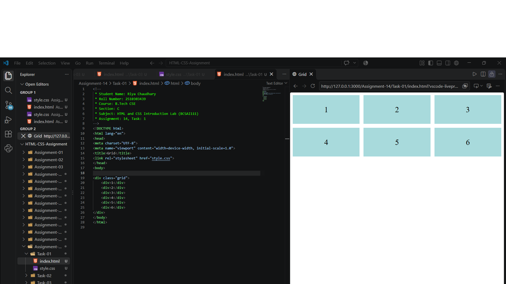
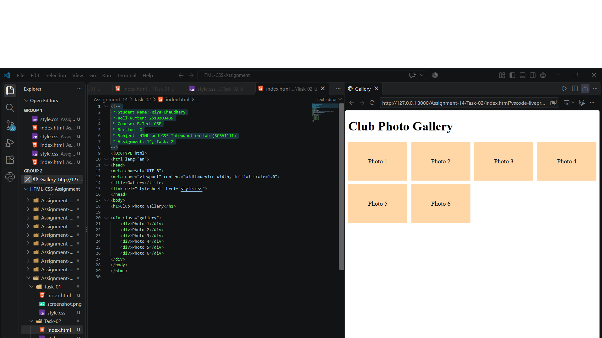
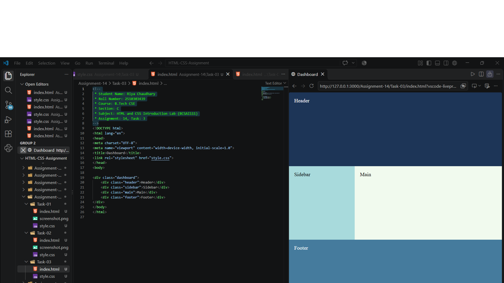

# Assignment 14: CSS Grid Layouts

## 1. Experiment Title

Creating Grid Layouts with Equal Columns, a Responsive Gallery and Named Areas.

## 2. Aim

To make a grid with equal columns, a responsive gallery and a layout with named areas.

## 3. Software / Tools Required

- Programming Language: HTML5 and CSS3
- Web Browser: Google Chrome / Microsoft Edge / Firefox
- IDE: VS Code / Sublime Text
- Any text editor (if IDE is not available)

## 4. Theory

The following concepts are used in this experiment:

**1. CSS Grid:**  
CSS Grid is a layout method that arranges items in rows and columns. Setting `display: grid` on a container turns it into a grid.

**2. Columns and Gap:**  
`grid-template-columns` sets the columns and `gap` sets the space between items. The `fr` unit shares the free space in equal parts.

**3. Responsive Columns:**  
`repeat(auto-fill, minmax(150px, 1fr))` fits as many columns of at least 150px as the width allows.

**4. Named Areas:**  
`grid-template-areas` names the parts of a layout and `grid-area` places an element in a named part.

## 5. Algorithm / Procedure

### Question 1: Three Equal Columns

1. Start the program.
2. Create six div boxes with the numbers 1 to 6.
3. Set `display: grid` on the container.
4. Set `grid-template-columns: 1fr 1fr 1fr`.
5. Set the gap to 12px.
6. Open the file in a browser.
7. Stop the program.

### Question 2: Responsive Gallery

1. Start the program.
2. Add the heading Club Photo Gallery.
3. Create six boxes labelled Photo 1 to Photo 6.
4. Set `grid-template-columns: repeat(auto-fill, minmax(150px, 1fr))`.
5. Set the gap to 10px.
6. Open the file in a browser and change the window width.
7. Stop the program.

### Question 3: Dashboard with Named Areas

1. Start the program.
2. Create four divs: header, sidebar, main and footer.
3. Set a grid with two columns: 200px and 1fr.
4. Define `grid-template-areas` with the header and footer across both columns.
5. Place each div using `grid-area`.
6. Open the file in a browser.
7. Stop the program.

## 6. Input

The following values are used in the experiment:

**Question 1:**  
Boxes = 1 to 6  
columns = 1fr 1fr 1fr  
gap = 12px

**Question 2:**  
Boxes = Photo 1 to Photo 6  
columns = repeat(auto-fill, minmax(150px, 1fr))  
gap = 10px

**Question 3:**  
columns = 200px 1fr  
Areas = header, sidebar, main, footer

## 7. Output

**Question 1:**  
Six boxes in two rows of three, with small gaps, are shown.

**Question 2:**  
As the window gets wider, more boxes fit in each row.

**Question 3:**  
A header across the top, a sidebar on the left, a main area on the right and a footer at the bottom are shown.

**Result:** The equal column grid, the responsive gallery and the dashboard with named areas were successfully created using CSS Grid.
