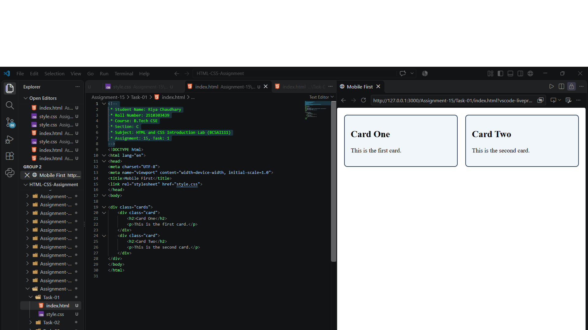
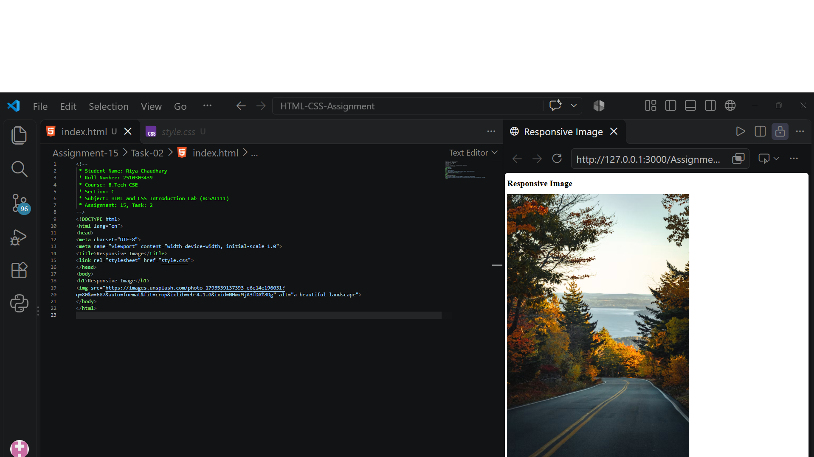
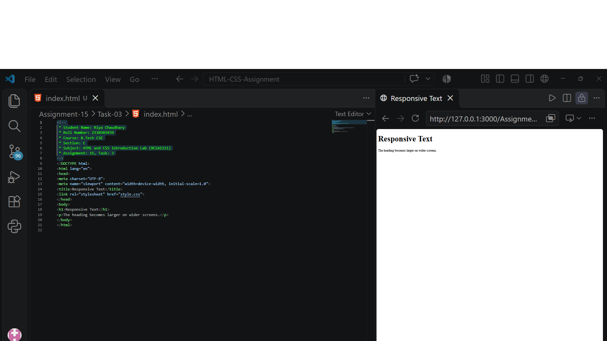

# Assignment 15: Responsive Pages with Media Queries

## 1. Experiment Title

Creating Responsive Layouts, Images and Text Using Media Queries.

## 2. Aim

To use a media query to change a layout, to make a picture scale with its box, and to set text sizes with rem units.

## 3. Software / Tools Required

- Programming Language: HTML5 and CSS3
- Web Browser: Google Chrome / Microsoft Edge / Firefox
- IDE: VS Code / Sublime Text
- Any text editor (if IDE is not available)

## 4. Theory

The following concepts are used in this experiment:

**1. Responsive Design:**  
A responsive page changes its layout to fit the size of the screen.

**2. Viewport Meta Tag:**  
`<meta name="viewport" content="width=device-width, initial-scale=1.0">` makes the page use the width of the device screen.

**3. Media Query:**  
`@media (min-width: 600px) { ... }` applies its rules only when the screen is 600px wide or more.

**4. Mobile-First Design:**  
The base styles are written for phones first and media queries add changes for larger screens.

**5. Responsive Image and Text:**  
`max-width: 100%` with `height: auto` makes a picture shrink to fit its box. The `rem` unit sets text sizes relative to the root font size.

## 5. Algorithm / Procedure

### Question 1: Mobile-First Cards

1. Start the program.
2. Add the viewport meta tag in the head.
3. Create a div with the class cards holding two cards.
4. Write an h2 heading and a paragraph in each card.
5. Write the base styles for phones.
6. Add a media query for 600px and up that sets `display: flex` on the cards.
7. Open the file in a browser and change the window width.
8. Stop the program.

### Question 2: Responsive Image

1. Start the program.
2. Add a heading and one picture.
3. Set `max-width: 100%` on the picture.
4. Set `height: auto` on the picture.
5. Open the file in a browser and change the window width.
6. Stop the program.

### Question 3: Responsive Text

1. Start the program.
2. Add an h1 heading and a paragraph.
3. Set the body font size to 1rem and the h1 to 1.5rem.
4. Add a media query for 600px and up that sets the h1 to 2.5rem.
5. Open the file in a browser and change the window width.
6. Stop the program.

## 6. Input

The following values are used in the experiment:

**Question 1:**  
Cards = Card One, Card Two  
Breakpoint = 600px

**Question 2:**  
h1 = "Responsive Image"  
max-width = 100%  
height = auto

**Question 3:**  
body = 1rem  
h1 = 1.5rem  
h1 at 600px and up = 2.5rem

## 7. Output

**Question 1:**  
On a phone the cards stack. At 600px and up they sit two per row.

**Question 2:**  
On a narrow window the picture shrinks to fit. On a wide window it keeps its own size.

**Question 3:**  
The heading is larger when the window is 600px wide or more.

**Result:** The responsive cards, the responsive image and the responsive text were successfully created using media queries.
